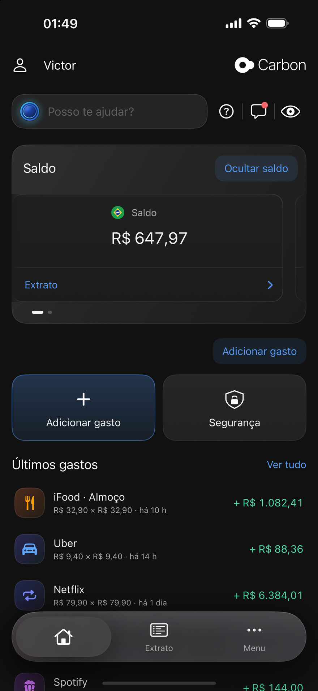

# CarbonC6 — Banco simulado (iOS 17+ · SwiftUI · SwiftData)

App nativo iOS-only, Dark Mode exclusivo, com design inspirado na tela de início
do C6 Carbon. **O valor gasto é multiplicado por ele mesmo (valor²).**
MVVM + SwiftData (offline-first) + Observation (`@Observable`) + Combine.

## Stack

| Camada | Tecnologia |
| --- | --- |
| UI | SwiftUI, `.ultraThinMaterial`, cantos `.continuous`, SF Pro, haptics (`UIImpactFeedbackGenerator(.medium)`, `sensoryFeedback`) |
| Estado | `@Observable` (Observation, iOS 17) com pipeline Combine (`PassthroughSubject`, `onReceive`) |
| Persistência | SwiftData (`@Model`, `@Relationship(deleteRule: .cascade)`) |
| Deploy target | iOS 17.0 · Swift 5.9 · Xcode 15+ |

## Estrutura

```
CarbonC6/
├── Models/          Account (saldo, pontos), Transaction (gasto, gasto²), TransactionCategory
├── Services/        SeedDataService, HapticService
├── ViewModels/      DashboardViewModel (regra +10% e exclusão), UserPreferences
├── DesignSystem/    CarbonTheme (paleta), componentes, glifos vetoriais, teclado customizado
├── Views/
│   ├── Dashboard/   DashboardView, BalanceCardView, QuickActionsView, RecentTransactionsView
│   ├── Sheets/      AddExpenseSheetView
│   └── Shared/      StatementView
├── Preview/         PreviewFactory (store em memória)
└── App/             CarbonC6App, ContentView
```

## Regra de negócio (central)

**O valor gasto é multiplicado por ele mesmo** e o resultado entra no saldo:

```
crédito   = valorGasto × valorGasto
novoSaldo = saldoAtual + crédito
```

- Exemplo: gastou **R$ 10,00** → 10 × 10 = **R$ 100,00** → saldo R$ 100,00 vira
  **R$ 200,00**.
- Implementado em `Earnings` (`Models/Account.swift`). Não existe tela de
  multiplicador configurável.
- Cada lançamento guarda `amount` (gasto) e `creditedAmount` (`gasto²`), então o
  extrato mostra "R$ 10,00 × R$ 10,00" e o valor que entrou no saldo.
- **Excluir lançamento:** botão **Excluir**, deslizar para a esquerda ou toque e
  segure a linha (Últimos gastos e Extrato). O crédito é devolvido do saldo.

Removidos nesta versão: cartão de crédito, investimentos, transferência/Pix,
C6 Assistant e qualquer oferta de crédito.

## Como rodar no seu iPhone (Victor · iPhone 16 Pro Max)

1. Abra `CarbonC6/CarbonC6.xcodeproj` no Xcode 15+.
2. Selecione o projeto → **Signing & Capabilities**:
   - marque **Automatically manage signing**;
   - escolha o seu **Team** (se nenhum aparecer: Xcode → Settings → Accounts →
     `+` → Apple ID → crie um *Personal Team* gratuito);
   - se aparecer erro de bundle id duplicado, troque
     `com.victor.carbonc6` por `com.victor.carbonc6.dev`.
3. Conecte o iPhone por cabo (e clique em "Confiar neste computador" no aparelho).
4. Selecione o **iPhone 16 Pro Max** como destino na barra do Xcode → **Run (⌘R)**.
5. No iPhone: **Ajustes → Geral → VPN e Gerenciamento de Dispositivo** →
   toque no seu Apple ID → **Confiar em "…"**.
6. App do desenvolvedor sem conta de pagamento expira em 7 dias — basta dar ⌘R
   de novo para reinstalar.

O deployment target é **iOS 17.0**, então roda no iOS 26 e no iOS 27 (você não
precisa mudar nada no projeto). O app força `UIUserInterfaceStyle = Dark`.

Sem cabo? Compile com **Deploy → Wireless** (Window → Devices and Simulators →
"Connect via network") com o iPhone na mesma rede Wi-Fi do Mac.

## Design (comparação com a referência)



`Docs/Screenshots/` traz todas as telas verificadas em Simulador iPhone 16 Pro Max
(1320×2868). Paleta extraída pixel a pixel da referência:

| Token | Hex | Uso |
| --- | --- | --- |
| `background` | `#111111` | fundo da página |
| `surface` | `#1B1B1B` | cards principais |
| `surfaceElevated` | `#1F1F1F` | atalho Pix |
| `surfaceMuted` | `#272727` | tiles de ação |
| `accent` | `#5499F5` | links e chips |
| `hairline` | `#333333` | divisórias |

Tipografia SF Pro (`.system`), raios `20/16/18` com estilo `.continuous`, materiais
`.ultraThinMaterial` no card de saldos e na tab bar flutuante, e feedback tátil
(`UIImpactFeedbackGenerator(.medium)` nos botões/teclado e `sensoryFeedback` no
sucesso).

## Harness de verificação (Debug)

Argumentos de lançamento para capturas e QA (`Edit Scheme → Run → Arguments`, ou
variáveis `SIMCTL_CHILD_...` com `xcrun simctl launch`):

| Argumento | Efeito |
| --- | --- |
| `-c6-reset` | recria o store e reseta preferências |
| `-c6-atoms-page` | abre na aba **Pontos** |
| `-c6-hidden` | abre com saldo oculto |
| `-c6-sheet=addExpense` / `statement` / `assist` | abre a sheet |
| `-c6-selftest` | roda as asserções da regra `saldo + gasto × multiplicador` (`SELFTEST_RESULT: PASS`) |

## Teste automatizado

`-c6-selftest` verifica: R$ 10 → R$ 100 creditados (100→200), R$ 5 → R$ 25
(200→225), exclusão devolve o crédito (225→125) e remove do extrato, valor zero
recusado. Resultado esperado no console: `SELFTEST_RESULT: PASS`.
